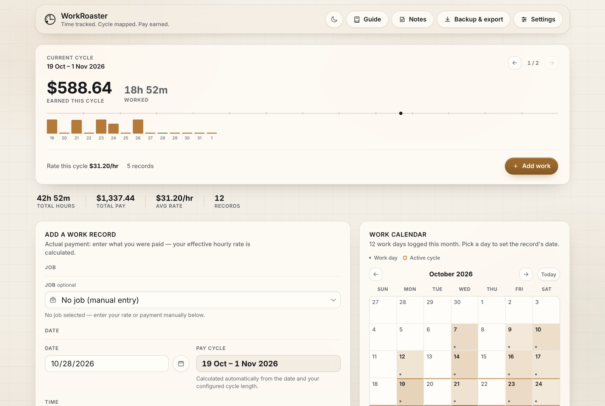
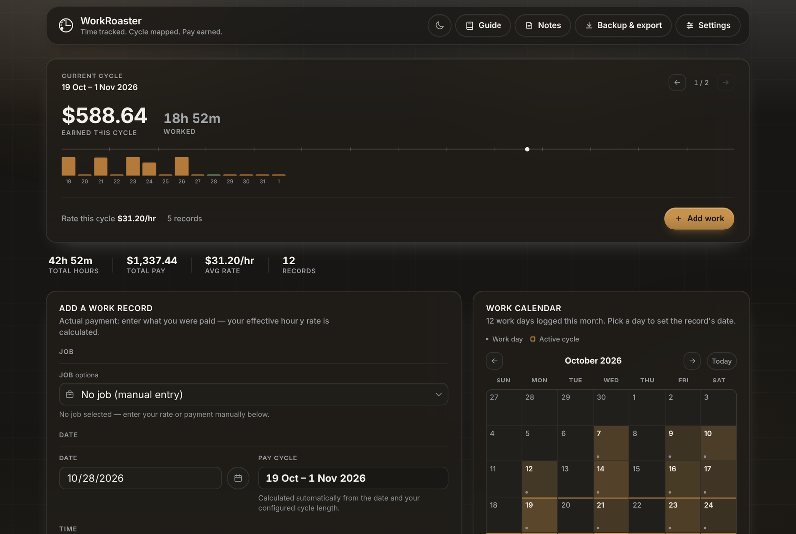
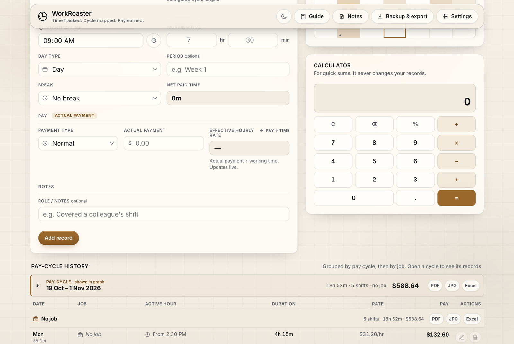
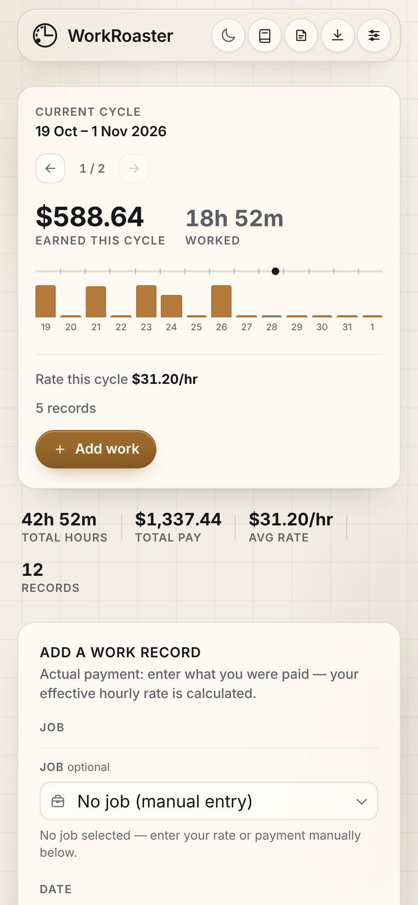

# WorkRoaster

A simple, personal work-hours and earnings tracker. Log shifts, watch your
hourly rate calculate itself, and see your pay laid out fortnight by
fortnight all having with multiple profile for different paycycle.

> Simple personal work tracker + earnings dashboard. Not enterprise HR
> software, not payroll software, not an accounting tool. A complete guide section has also been added for better understanding of every feature that is currently available.

## Features

- **Add a shift in seconds** — date, start time, working hours & minutes,
  pay, and it's logged. Your hourly rate is calculated automatically from
  payment ÷ actual working time; you never type a rate in yourself.
- **Accurate duration math** — working time is entered as hours *and*
  minutes (e.g. `2 hr 22 m`), never as a hand-typed decimal, so a shift
  is never accidentally treated as `2.22` hours instead of `2.3667`.
- **Pay-cycle grouping** — records are grouped into fortnights/pay cycles
  and ordered by each cycle's *starting* date, most recent first. A cycle
  that starts later always outranks one that started earlier, regardless
  of which one's end date is further away.
- **Dashboard stats** — latest fortnight hours & pay, overall hours & pay,
  and your overall weighted average hourly rate (total earnings ÷ total
  hours — not an average of each day's individual rate).
- **Insights** — your usual starting time and overall average $/hr, based
  on everything you've logged.
- **Configurable options** — day types and payment types are yours to
  edit in Settings: add, rename, reorder, or retire them. An option in
  use by existing records can't be silently deleted — it's archived
  instead, so historical records keep showing exactly what you recorded.
- **Backup & restore** — export a full JSON backup or a CSV of your
  records at any time, and re-import a JSON backup later (merge with, or
  replace, what's already there).
- **Light & dark themes**, keyboard-accessible forms and modals, and a
  responsive layout for desktop, tablet and phone.
- **Your data stays on your device.** WorkTrack has no backend — records
  live in your browser's `localStorage` and never leave it unless you
  export them yourself.

## Screenshots

The current pay cycle, totals and the work calendar, in the light and dark themes:





Adding a record, the built-in calculator and the pay-cycle history:



On a phone:



## Getting started

Requires [Node.js](https://nodejs.org/) 18 or later.

```bash
npm install
npm run dev
```

Then open the local URL Vite prints (usually `http://localhost:5173`).

To build a static production bundle you can deploy anywhere (GitHub
Pages, Netlify, Vercel, or just a folder on any web server):

```bash
npm run build
npm run preview   # optional: preview the production build locally
```

The build output lands in `dist/` and is a plain set of static files —
no server-side code required.

## Project structure

```
WorkTrack/
├── README.md
├── package.json
├── index.html          # entry HTML, loads src/app.js as a module
├── src/
│   ├── app.js           # UI state, rendering, and event wiring
│   ├── calculations.js  # pure math: durations, rates, cycle sorting, insights
│   ├── storage.js       # localStorage load/save, migration, backup/CSV
│   ├── settings.js      # configurable option-list logic (day/payment types)
│   └── styles.css       # design tokens + component styles, light & dark
├── assets/               # icons/images (currently empty — add your own)
└── docs/
    └── data-model.md     # record & settings shape, migration notes
```

## How data is stored

Everything lives in your browser's `localStorage`, under two keys:

| Key | Contents |
|---|---|
| `modern_work_hours_tracker_v1` | The array of work records — the exact key and shape used by earlier versions of this tracker, kept unchanged so upgrading never loses data. |
| `modern_work_hours_tracker_v1_settings` | Day types, payment types, currency, theme and default values. Introduced by this version; missing on first run, so it's created with sensible defaults automatically. |

See [`docs/data-model.md`](docs/data-model.md) for the exact record shape
and how older/partial data is migrated in place.

Because everything is local to one browser profile, records **do not**
sync between devices or browsers on their own — use the JSON backup/
restore in the "Backup & export" panel to move data between them.

## Privacy & terms

WorkRoaster has no accounts, ads, analytics or tracking, and nothing you enter is sent anywhere. Settings → Feedback opens your own email app with your message ready to send; nothing leaves your device until you press Send there.

- Privacy Policy: https://www.simplymadestudio.net/privacy#workroaster
- Terms of Use: https://www.simplymadestudio.net/terms#workroaster
- Both are linked in the app under Settings → Privacy & terms.

WorkRoaster is a record-keeping tool, not payroll software, and does not give financial, tax or legal advice.

## Backup & restore

Open **Backup & export** from the header:

- **Download JSON backup** — a complete snapshot (records + settings).
  Keep this somewhere safe; it's the file to restore from.
- **Download CSV** — your records as a spreadsheet-friendly file, for
  Excel/Sheets or your own analysis. This is export-only (CSV isn't used
  for restoring, since it can't safely carry your settings/options).
- **Import & merge** — add records from a JSON backup to what's already
  here; duplicates (matching IDs) are skipped automatically.
- **Import & replace all** — wipe current records and load the backup's
  instead. You'll be asked to confirm first.
- **Clear all records** — an explicit, confirmed reset. Export a backup
  first if there's any chance you'll want the data again.

## Configurable options & data safety

Day types and payment types are edited from **Settings → Options**. The
one rule that's non-negotiable: **editing an option never rewrites or
deletes history that already exists.**

- Renaming an option updates the option's label going forward. You're
  then asked, separately, whether existing records using the old label
  should be updated to match — say no, and they keep showing exactly
  what you originally recorded.
- Deleting an option that's still used by at least one record archives
  it instead of removing it: it disappears from the dropdown for new
  records, but every existing record keeps its original value, visible
  and intact. Only an option with zero matching records can be deleted
  outright.

## Why vanilla JavaScript (not React)?

WorkTrack is a single-user, offline-first tool with one screen and a
handful of interactive pieces — a form, a list, two modals. That's well
within what plain DOM rendering handles comfortably, so a UI framework
would add build complexity and a dependency tree without buying much.
[Vite](https://vitejs.dev/) is used purely as a dev server and bundler
(instant reload, ES module support, a `dist/` build for deployment) — it
doesn't dictate a framework. This also keeps the codebase approachable
if you're using it, as I am, to learn: every file maps to one concern
(`calculations.js` has no DOM code in it at all, for instance), and
there's no framework-specific API to learn on top of the DOM itself.

If WorkTrack grows more views, nested state, or multi-user features
later, that's the point at which React (with Vite's React plugin) would
start paying for itself — the project structure here doesn't block that
migration.

## Contributing

Issues and pull requests are welcome. A few things that keep changes
easy to review:

- Keep `calculations.js` free of DOM/localStorage code — it should stay
  usable (and testable) as pure functions.
- If you change the shape of a stored record or settings object, add a
  migration path in `storage.js` rather than assuming existing users'
  data matches the new shape — see `docs/data-model.md`.
- Run `npm run build` before opening a PR to make sure nothing's broken.

## License

MIT — see [`LICENSE`](LICENSE).
